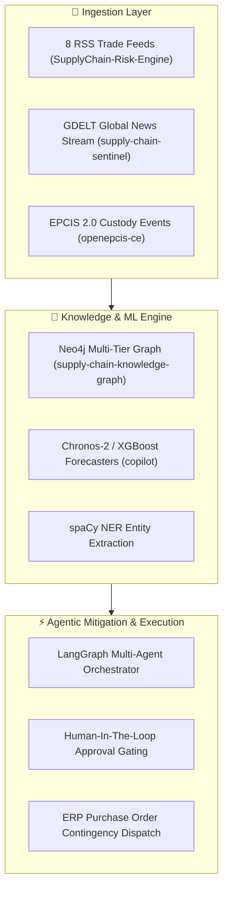

  

# 📦 Awesome Supply Chain Supplier & Material Trapping Engines

  
  
  
  
  
  

> **A curated directory of enterprise SaaS solutions and open-source intelligence engines for Supply Chain Risk Management (SCRM), multi-tier supplier mapping, component deficit trapping, and real-time operational disruption mitigation.**

---

## 📑 Table of Contents

- [🔍 Overview & Core Concepts](#-overview--core-concepts)
- [📊 Sector Overview & Market Dynamics](#-sector-overview--market-dynamics)
- [🏢 Enterprise SaaS & Hosted Platforms](#-enterprise-saas--hosted-platforms)
- [💻 Open-Source GitHub Projects](#-open-source-github-projects)
- [🛠️ Recommended Architectures](#️-recommended-architectures)
- [📈 Star History](#-star-history)
- [🤝 How to Contribute](#-how-to-contribute)
- [💖 Support & Community](#-support--community)
- [⚖️ Disclaimer](#️-disclaimer)

---

## 🔍 Overview & Core Concepts

In today's interconnected global economy, supply chain resilience is paramount. **Supplier & Material Trapping Engines** empower organizations to proactively detect single points of failure, forecast component and raw-material shortages, monitor multi-tier supply networks (Tier-1 through Tier-N), and trigger automated mitigation actions before disruption halts production.

Key capabilities tracked across these platforms include:
- 🚨 **Early-Warning Disruption Sensing**: Ingesting real-time news, geopolitical shifts, satellite weather, port congestion, and seismic data to calculate location-specific risk indexes.
- 🧩 **Component Deficit Trapping**: Detecting bill-of-materials (BOM) vulnerabilities, single-source dependency chokepoints, and lead-time volatility.
- 🌐 **Multi-Tier Supplier Mapping**: Uncovering sub-tier dependencies (Tier-2 to Tier-4) hidden beneath direct vendor relationships.
- 🤖 **Agentic & Automated Mitigation**: Leveraging autonomous decision models and multi-agent workflows to recommend dual-sourcing alternatives and automate contingency purchase orders.

---

## 📊 Sector Overview & Market Dynamics

The global **Supply Chain Risk Management (SCRM) and Supplier Intelligence** sector is currently valued at approximately **$4.2 Billion** and is projected to reach **$10.5 Billion by 2032**, expanding at a robust compound annual growth rate (**CAGR of ~14.1%**), driven by increasing geopolitical volatility, climate events, and strict global compliance mandates (e.g., EU CSDDD, German LkSG, US UFLPA).

The market is **moderately fragmented** rather than a winner-take-all ecosystem: while enterprise spend management titans (such as Coupa and Sphera) lead unified corporate procurement workflows, specialized category leaders (such as Resilinc for deep hardware/semiconductor mapping, Everstream for predictive transit logistics, and Prewave for regulatory ESG risk) hold defensible vertical moats, alongside a thriving open-source ecosystem that offers sovereign, self-hosted, and transparent alternatives.

---

## 🏢 Enterprise SaaS & Hosted Platforms

The table below catalogs premier commercial SaaS solutions for supplier risk intelligence, material shortfall trapping, and global disruption alerts. Platforms are sorted in **descending order by company size** (market capitalization, enterprise valuation, or annual revenue run-rate).

| Platform / Vendor | Description & Focus Capabilities | Company Size (Valuation / Revenue) | Specific Starting Pricing | Free Tier / Free Trial Limits |
| :--- | :--- | :--- | :--- | :--- |
| **[Coupa](https://www.coupa.com/)** | Comprehensive Business Spend Management (BSM) platform offering automated supplier health tracking, ESG risk scoring, and spend resilience analytics. | **$8.0B Valuation** *(Acquired by Thoma Bravo; ~$850M+ ARR)* | Starts at **$15,000/year** ($1,250/mo) for baseline procurement essentials; enterprise risk suites scale from **$100,000/year** | **Free Forever plan** on Coupa Supplier Portal (CSP) for unlimited digital PO receipt & invoice processing; 30-day buyer POC demo |
| **[Project44](https://www.project44.com/)** | Global supply chain visibility platform tracking multi-modal shipments (ocean, air, rail, truckload) with real-time ETA disruption intelligence. | **$2.7B Valuation** *(Series F; ~$180M+ ARR)* | Starts at **$100/user/month** ($1,200/yr baseline); enterprise freight tracking contracts start at **$25,000/year** | **Free Forever carrier portal** with unlimited dispatch updates; 14-day guided shipper sandbox trial with sample API feeds |
| **[Sphera Supply Chain](https://sphera.com/)** | Enterprise ESG, product compliance, and operational supply chain risk management platform (incorporating former riskmethods and BOMcheck). | **$1.4B Valuation** *(Acquired by Blackstone; ~$220M+ ARR)* | Sphera BOMcheck starts at **€329/user/year**; enterprise SCRM platform begins at **$15,000/year** ($1,250/mo) | **Free tier** on BOMcheck for small vendors (<€3M turnover) to file compliance declarations; 14-day guided SCRM pilot |
| **[Interos](https://www.interos.ai/)** | AI-driven operational resilience and supplier risk platform mapping multi-tier global supply chains across financial, cyber, ESG, and geopolitical dimensions. | **$1.0B Valuation** *(Unicorn status, Series D; ~$50M ARR)* | Starts at **$18,000/year** ($1,500/mo) for monitoring up to 250 entities; AWS Marketplace private offers scale from **$25,000/year** | **14-day evaluation sandbox** with up to 50 supplier risk scorecards and automated disruption simulation |
| **[Overhaul](https://overhaul.com/)** | Real-time supply chain visibility, risk management, and cargo integrity engine combining IoT hardware sensors with a 24/7 Global Security Operations Center. | **$450M Valuation** *($110M+ raised; ~$55M ARR)* | Starts at **$2,500/month** ($30,000/year) for core IoT sensor tracking; 24/7 active intervention packages start at **$60,000/year** | **30-day pilot program** limited to 5 high-priority transit lanes or 10 active IoT device deployments |
| **[Prewave](https://www.prewave.com/)** | AI-powered supply chain risk and regulatory due diligence engine scanning millions of multilingual news, social, and governmental sources for ESG & disruption alerts. | **$350M Valuation** *(€63M Series B; ~$25M ARR)* | Starts at **€249/month** (€2,988/yr billed annually) for Tier-1 risk alerts; full ESG & compliance suites begin at **€15,000/year** | **14-day full-feature sandbox trial** with up to 20 tracked supplier profiles and real-time news alerts |
| **[Resilinc](https://www.resilinc.com/)** | Category pioneer in multi-tier supply chain mapping, component deficit trapping, and EventWatch AI disruption monitoring across critical manufacturing sectors. | **$280M Valuation** *(Vista Equity backed; ~$45M ARR)* | Starts at **$1,400/month** ($16,800/yr) for EventWatch AI alerting; multi-tier mapping deployments start at **$80,000/year** | **14-day trial** of EventWatch AI with global disruption map access and up to 10 mapped supply chain partner notifications |
| **[Everstream Analytics](https://www.everstream.ai/)** | Predictive supply chain risk analytics platform synthesizing weather anomalies, geopolitical conflict, port strikes, and financial risks into predictive impact scoring. | **$180M Valuation** *(DHL / Columbia Capital; ~$30M ARR)* | Starts at **$2,083/month** ($25,000/year) for the Asset Protect / Global Protect predictive disruption package | **14-day disruption risk simulation trial** restricted to 5 trade lanes or 10 critical facilities upon demo registration |
| **[Riskmethods](https://www.riskmethods.net/)** | Automated threat-radar platform scoring supplier risk, catastrophic exposure, and financial delinquency (now part of the Sphera ecosystem). | **$150M Val. at Acquisition** *(~$20M ARR)* | Starts at **$1,500/month** ($18,000/year) for baseline monitoring of up to 250 supplier nodes | **14-day guided proof-of-concept trial** with active threat radar for up to 100 suppliers |
| **[Craft.co](https://www.craft.co/)** | Enterprise supplier intelligence and market intelligence platform aggregating deep financial health, cybersecurity posture, and corporate linkage data. | **$75M Valuation** *($25M raised; ~$15M ARR)* | Starts at **$833/month** ($10,000/yr via Salesforce AppExchange); standalone enterprise data licenses start at **$12,000/year** | **Free Forever community tier** with 5 company searches & profile previews/month; 14-day enterprise trial with 50 company credits |

---

## 💻 Open-Source GitHub Projects

The following repositories represent self-hostable tools, machine learning frameworks, digital twins, and multi-agent systems designed for supplier risk assessment, material shortage tracking, and resilience engineering. 

Repositories are sorted in **descending order by GitHub stargazers count**.

| Repository & Stars_Badge | Description & Architectural Highlights | Tech Stack |
| :--- | :--- | :--- |
| **[GreaterWMS](https://github.com/GreaterWMS/GreaterWMS)**  | Open-source warehouse and logistics operating system derived from Ford Asia Pacific supply chain processes; optimizes inventory allocation, material staging, and deficit prevention. | Python, Django, Vue.js, Quasar, SQLite/PostgreSQL |
| **[fleetbase](https://github.com/fleetbase/fleetbase)**  | Modular logistics and supply chain operating system (LSOS) for orchestrating vendor fulfillment, multi-stop routing, live tracking, and transport visibility. | PHP, Laravel, Ember.js, Docker, MySQL |
| **[ofbiz-framework](https://github.com/apache/ofbiz-framework)**  | Comprehensive Apache enterprise ERP and supply chain framework featuring advanced MRP, inventory allocation, purchase order management, and multi-tier supplier coordination. | Java, Gradle, Groovy, Lucene, XML |
| **[Manifest](https://github.com/hock/Manifest)**  | Open investigative toolkit for visualizing, analyzing, and documenting supply chain networks and trade flows without proprietary cloud lock-in. | JavaScript, Leaflet, D3.js, GeoJSON |
| **[WorldPulse](https://github.com/xenosaac/WorldPulse)**  | AI-powered geopolitical intelligence platform that translates global events into real-time supply chain risk assessments, powered by Google Gemini. | Python, Streamlit, Google Gemini API |
| **[Supply-Chain-Risk-Management](https://github.com/menikhilpandey/Supply-Chain-Risk-Management)**  | Machine learning predictive framework evaluating supplier accountability, delivery reliability metrics, and supplier failure probabilities. | Python, Scikit-learn, Pandas, Jupyter |
| **[Agentic-SupplyChain-Decision-System](https://github.com/pattyish/Agentic-SupplyChain-Decision-System)**  | Agentic AI system that integrates predictive models and retrieval-augmented knowledge (RAG) to autonomously analyze supply chain risks and recommend optimal decisions. | Python, LangChain, RAG, ChromaDB |
| **[epcis-repository-ce](https://github.com/openepcis/epcis-repository-ce)**  | OpenEPCIS Community Edition GS1 EPCIS 2.0 repository providing event-driven supply chain tracking, custody transfer, and digital product passport verification. | Java, Quarkus, OpenSearch, Kafka, Docker |
| **[CaSRA-Supplier-Disruption-Prediction](https://github.com/Atik1219/CaSRA-Supplier-Disruption-Prediction-Dataset)**  | Multi-source supplier risk assessment suite and dataset blending knowledge graphs, semantic similarity, and disruption signals for supplier resilience modeling. | Python, PyTorch Geometric, RDF, Pandas |
| **[FGCS-SCRM](https://github.com/gmparg/FGCS-SCRM)**  | Interpretable machine-learning engine balancing predictive risk accuracy with explainable SHAP features for enterprise supplier risk auditing. | Python, XGBoost, SHAP, Scikit-learn |
| **[ISOMORPH](https://github.com/tuhinsahai/ISOMORPH)**  | User-extensible Supply Chain Digital Twin engine for material flow simulation, synthetic disruption generation, and resilience stress-testing. | Python, NetworkX, NumPy, SimPy |
| **[Forecast-Intelligence-Hub](https://github.com/joycequ196/Forecast-Intelligence-Hub)**  | Enterprise-level demand/material forecasting engine designed to prevent stockouts, trap material deficit risks, and boost inventory resilience. | Python, Statsmodels, Prophet, PyTorch |
| **[supply-chain-reasoning-engine](https://github.com/john-carroll-sw/supply-chain-reasoning-engine)**  | Adaptive supply chain optimization system using AI reasoning models for real-time disruption response and resilience bottleneck discovery. | Python, FastAPI, Anthropic/OpenAI APIs |
| **[resilio](https://github.com/codingnoodle/resilio)**  | Cognitive supply chain engine with Agentic GraphRAG built for active supplier dependency analysis and pharmaceutical/critical material resilience. | Python, LangChain, Neo4j, GraphRAG |
| **[autonomous-supply-chain-watchdog](https://github.com/aniket-work/autonomous-supply-chain-watchdog)**  | Autonomous watchdog scanning global news for disruptions, commodity price shocks, and raw material deficits with interactive Streamlit reports. | Python, Phidata, GPT-4o, DuckDuckGo API |
| **[SupplyChain-Risk-Engine](https://github.com/Ali-datasmith/SupplyChain-Risk-Engine)**  | Real-time risk scoring engine using Polars, DuckDB & Streamlit, analyzing financial and geographic risk per vendor across 8 continuous news/RSS streams. | Python 3.12+, Polars, DuckDB, Streamlit |
| **[Supply-Chain-Intelligence-System](https://github.com/akshxnsh/Supply-Chain-Intelligence-System)**  | Multi-agent disruption monitor cross-referencing news, weather alerts, and port congestion with ERP supplier relationships and purchase orders. | Python, Google ADK, BigQuery, Docker |
| **[AI-Driven-Forecast-Resilience-Simulator](https://github.com/AquarlisPrime/AI-Driven-Forecast-Resilience-Simulator-for-Supply-Chain)**  | Digital twin simulation engine pairing Monte Carlo disruption simulations with Prophet/XGBoost/LSTM demand models for risk tradeoff analysis. | Python, Prophet, XGBoost, LSTM |
| **[supplychain_resilience_copilot](https://github.com/Bhardwaj-Saurabh/supplychain_resilience_copilot)**  | Multi-agent decision-support architecture using Chronos-2, XGBoost stockout classifiers, and LangGraph agents with human-in-the-loop gating. | Python 3.11+, LangGraph, Chronos-2 |
| **[supply-chain-sentinel](https://github.com/jadzoghaib/supply-chain-sentinel)**  | Autonomous sentinel combining GDELT event data with an LLM risk pipeline and n8n orchestration for scheduled supplier sweeps and geospatial impact evaluation. | Python, FastAPI, n8n, GDELT API |
| **[supply-chain-knowledge-graph](https://github.com/virbahu/supply-chain-knowledge-graph)**  | Multi-tier knowledge graph construction pipeline using spaCy NER, Neo4j, and FastAPI for multi-hop sub-tier supplier dependency queries. | Python, spaCy, Neo4j, FastAPI, GraphQL |
| **[supplier-risk-ai-v3](https://github.com/virbahu/supplier-risk-ai-v3)**  | Real-time supplier risk assessment and automated mitigation tool grounded in research from UCLA Anderson, supporting 1K to 100K+ SKUs. | Python, NumPy, Pandas, REST API |
| **[sc-control-tower](https://github.com/virbahu/sc-control-tower)**  | Supply chain visibility control tower based on MIT CTL methodology for end-to-end multi-echelon inventory tracking and buffer optimization. | Python, SciPy, Matplotlib, Streamlit |
| **[open-source-supply-chain-risk-mcp](https://github.com/apifyforge/open-source-supply-chain-risk-mcp)**  | Model Context Protocol (MCP) server providing AI agents with live dependency mapping, maintainer bus-factor scoring, and supplier network analysis. | TypeScript, Node.js, MCP Protocol |
| **[eeve](https://github.com/JadeSamLee/eeve)**  | Graph analytics suite using ArangoDB and cuGraph Louvain community detection to detect vulnerable product and supplier clusters. | Python, ArangoDB, RAPIDS cuGraph |
| **[AI-Driven-Disruption-Predictor](https://github.com/AnulipiJana/AI-Driven-Supply-Chain-Disruption-Predictor-and-Inventory-Optimization-System)**  | Real-time news and weather intelligence system using transformer NLP (BERT/T5) to predict component deficits and trigger inventory re-allocations. | Python, Hugging Face Transformers, Flask |
| **[stochastic-learning-optimization](https://github.com/adeel498/stochastic-learning-optimization)**  | Bayesian learning combined with stochastic optimization for material allocation in resilient automotive and discrete manufacturing supply chains. | Python, PyMC, SciPy, Pandas |

---

## 🛠️ Recommended Architectures

### 🏗️ Building a Complete Self-Hosted SCRM Stack

For organizations seeking data sovereignty, customized risk weighting, and zero per-supplier SaaS fees, you can assemble an end-to-end resilience engine using modular open-source components:

---

## 📈 Star History

---

## 🤝 How to Contribute

Contributions are welcome and actively encouraged! To contribute:

1. 🍴 **Fork the repository**.
2. 🌿 **Create a feature branch**: `git checkout -b feature/add-new-engine`.
3. 📝 **Add or update entries** following the established tabular format:
   - For SaaS: include Vendor Name, Focus Capabilities, Company Size (Valuation/Revenue), Specific Starting Pricing, and Free Tier/Trial limits.
   - For Open-Source: include Repository Name, Stars_Badge (`style=social&color=white`), concise description, and tech stack.
4. 🚀 **Submit a Pull Request** with a concise description of your additions.

---

## 💖 Support & Community

Thank you for visiting and using **Awesome Supply Chain Supplier & Material Trapping Engines**! If this repository has assisted your procurement, logistics, or risk intelligence initiatives, please consider supporting the project:

- ⭐ **Star this repository** to help others discover it and follow along with updates.
- 🍴 **Fork and contribute** new open-source projects, benchmarks, and research tooling.
- 📢 **Share with peers** across manufacturing, operations, and supply chain communities.
- ☕ **Support the maintainer**: You can sponsor or buy a coffee via the [GitHub Sponsor Dashboard](https://github.com/sponsors/ishandutta2007).

  

---

## ⚖️ Disclaimer

- This repository is a community-curated resource for informational and educational purposes. Mention of specific vendors or open-source projects does not constitute a formal commercial endorsement.
- Organizations deploying automated supply chain risk systems must comply with relevant data protection legislation (GDPR, CCPA), customs compliance regulations, and commercial confidentiality agreements.
- Open-source implementations should be thoroughly evaluated, benchmarked, and security-hardened prior to production enterprise deployment.

---

  <b>Built for supply chain risk managers, procurement specialists, and resilience engineers worldwide. 🌐</b>

